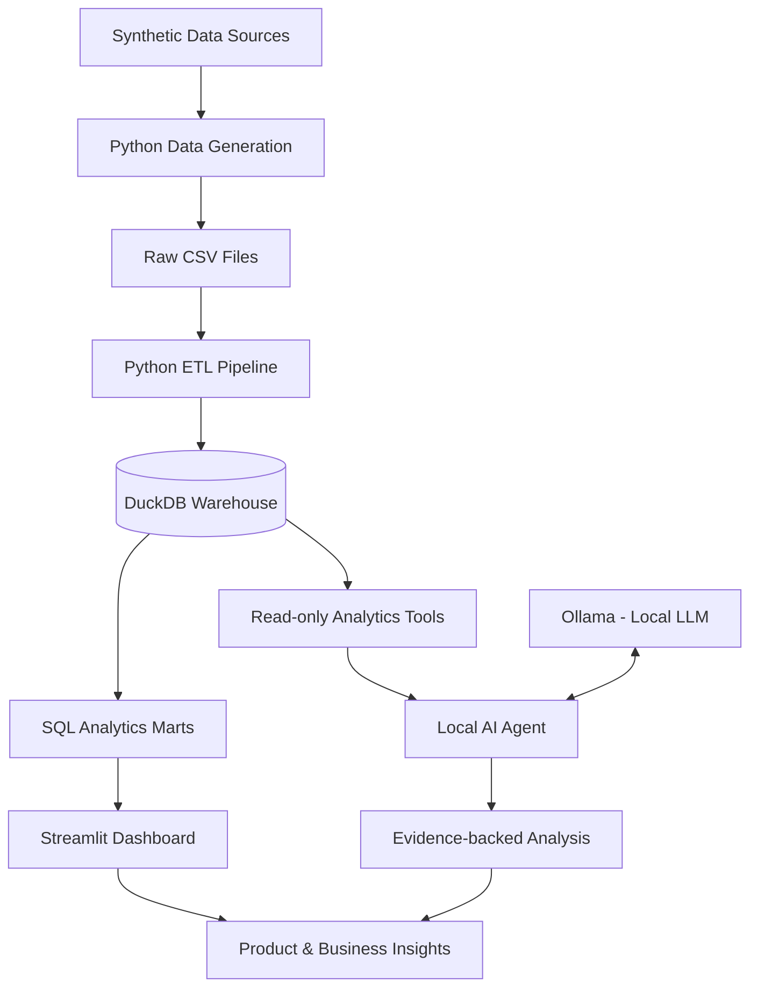

# FleetPulse Intelligence
### Connected Fleet Analytics & Local Agentic AI

FleetPulse Intelligence is an independent analytics prototype that explores how connected-vehicle and fleet-platform data can be transformed into actionable product and operational insights.

The project combines a synthetic data pipeline, a DuckDB analytics warehouse, product performance dashboards and a locally running AI analytics agent. It is designed to investigate business questions, identify changes in product engagement, analyse customer and feature performance, and produce evidence-backed recommendations.

**This is an independent portfolio project inspired by connected fleet analytics. It is not affiliated with, endorsed by, or built using proprietary data from Geotab or any other fleet technology provider. All data is synthetic.**

---

## Project Overview

Fleet platforms generate data across customers, vehicles, subscriptions, platform interactions and product features. Turning these sources into reliable business insights requires more than a dashboard: it requires a consistent data model, clearly defined metrics, reliable transformations and the ability to investigate changes.

FleetPulse addresses this through three layers:

1. **Product Analytics:** Understand adoption, engagement, retention, feature performance and revenue.
2. **Data Engineering:** Generate, transform, validate and model synthetic data in an analytical warehouse.
3. **Agentic Analytics:** Allow a local AI agent to investigate business questions using predefined analytical tools and verified data.

### Example Business Question

> Platform engagement has declined over the last 30 days. Is the decline real? Which customer segments and features are responsible? What might be driving the change, and what should the product team investigate next?

FleetPulse is designed to investigate this question using SQL-based analysis and an AI agent that retrieves supporting evidence before producing its response.

---

## Architecture



### Technology Stack

| Layer | Technologies |
|---|---|
| Programming | Python |
| Data processing | Pandas, NumPy |
| Data warehouse | DuckDB |
| Data transformations | SQL |
| Dashboard | Streamlit, Plotly |
| AI inference | Ollama, locally hosted LLM |
| Agent implementation | Python, custom tool-calling workflow |
| Testing | Pytest |
| Version control | Git, GitHub |

The application is designed to run locally. No paid LLM APIs, external inference services or cloud-hosted databases are required.

---

## Key Capabilities

### 1. Product Analytics

The dashboard provides an analytical view of customer and platform performance.

Areas covered include:

- Customer and vehicle adoption
- Daily, weekly and monthly active users
- Customer engagement and usage intensity
- Feature adoption and performance
- Customer retention and cohort analysis
- Subscription revenue and monthly recurring revenue
- Customer usage-risk segmentation
- Product engagement decline investigation

Metrics are calculated from the underlying warehouse rather than generated by the AI model.

### 2. Data Engineering & Analytics Warehouse

The project uses synthetic source data to simulate a connected fleet platform.

**Source datasets**

- Customers
- Vehicles
- Product features
- Platform events
- Vehicle activity
- Subscriptions

**Warehouse dimensions**

- `dim_customers`
- `dim_vehicles`
- `dim_features`
- `dim_date`

**Warehouse fact tables**

- `fact_platform_events`
- `fact_vehicle_activity`
- `fact_subscriptions`

**Analytical marts**

- `mart_product_adoption`
- `mart_customer_engagement`
- `mart_feature_performance`
- `mart_customer_retention`
- `mart_revenue_performance`
- `mart_cohort_retention`

The pipeline follows a reproducible process:

1. Generate synthetic source datasets.
2. Load source files into DuckDB staging tables.
3. Transform staging data into dimensional and fact tables.
4. Create analytical SQL views and marts.
5. Run data quality checks.
6. Serve the resulting metrics to the dashboard and agent.

### 3. Data Quality & Validation

Data quality checks are included to validate the reliability of the analytical outputs.

Examples include:

- Events recorded after customer churn
- Vehicle activity before activation
- Invalid event counts
- Disconnected vehicles recording positive distance
- Feature usage below the customer's subscription tier
- Churned subscriptions with non-zero MRR
- Missing customer attributes
- Invalid subscription tiers
- Subscription and revenue consistency

Each check returns a violation count, allowing the pipeline to identify potential data issues before analytical results are consumed.

### 4. Local Agentic Analytics

The AI layer is designed to act as an analytical assistant rather than an unrestricted chatbot.

Instead of asking an LLM to invent SQL or calculate business metrics independently, the agent uses a predefined collection of analytical tools to retrieve information from DuckDB.

Its intended capabilities include:

- Retrieve platform performance metrics.
- Compare current and previous reporting periods.
- Break down changes by customer segment.
- Investigate feature-level engagement.
- Identify customers with declining usage.
- Examine the timing of engagement changes.
- Retrieve data quality results.
- Explain findings using supporting evidence.

**Agent design principles**

- Read-only access to analytical data.
- Bounded, predefined tool access.
- Consistent metric definitions.
- Evidence-first responses.
- Explicit distinction between observed changes and possible explanations.
- No unsupported causal claims.

The LLM runs locally through Ollama. This keeps inference independent of paid external APIs and allows the application to operate without API keys.

---

## Synthetic Data & Business Scenario

FleetPulse uses reproducible synthetic data to simulate a fleet technology platform.

The current dataset is configured with:

| Attribute | Configuration |
|---|---:|
| Customers | 240 |
| Historical coverage | 150 days |
| Regions | 4 |
| Industries | 6 |
| Subscription tiers | 3 |
| Product features | 8 |

The synthetic data includes a deliberately introduced engagement decline affecting selected European customer segments and product features.

This creates a controlled business scenario for testing:

- Whether an aggregate decline is occurring.
- Whether it is concentrated in particular segments.
- Which features contribute to the decline.
- Whether customer churn or reduced usage is responsible.
- Whether the decline develops gradually or suddenly.
- Which customer groups may require further investigation.

The scenario is intentionally designed for analytical investigation, not as a claim about real-world fleet platform behaviour.

---

## Repository Structure

```text
fleetpulse-intelligence/
│
├── app/
│   └── dashboard.py
│
├── src/
│   ├── agent/
│   │   ├── __init__.py
│   │   ├── agent.py
│   │   ├── prompts.py
│   │   └── tools.py
│   │
│   ├── generate_data.py
│   ├── etl.py
│   ├── build.py
│   └── quality.py
│
├── sql/
│   ├── schema.sql
│   ├── 02_marts.sql
│   └── 03_decline_investigation.sql
│
├── data/
│   ├── raw/
│   └── warehouse/
│
├── tests/
│   ├── test_agent_questions.py
│   └── test_agent_tools.py
│
├── .gitignore
├── requirements.txt
└── README.md
```

Generated data and the DuckDB warehouse are created locally and do not need to be committed to GitHub.

---

## Running Locally

### Prerequisites

- Python 3.10 or later
- Git
- Ollama
- A locally supported LLM
- Windows, macOS or Linux

### 1. Clone the repository

```bash
git clone https://github.com/YOUR_USERNAME/fleetpulse-intelligence.git

cd fleetpulse-intelligence
```

Replace `YOUR_USERNAME` with your GitHub username.

### 2. Create a virtual environment

Windows PowerShell:

```powershell
python -m venv .venv

.venv\Scripts\Activate.ps1
```

### 3. Install dependencies

```powershell
pip install -r requirements.txt
```

### 4. Generate data and build the warehouse

```powershell
python -m src.build
```

The build process generates the synthetic datasets if they do not already exist, loads the warehouse and creates the analytical views.

### 5. Run data quality checks

```powershell
python -m src.quality
```

### 6. Start the dashboard

```powershell
streamlit run app/dashboard.py
```

Open:

```text
http://localhost:8501
```

### 7. Set up the local AI model

Install Ollama from:

https://ollama.com/download

Pull the configured model:

```powershell
ollama pull qwen3:4b
```

Ollama provides a local inference endpoint at:

```text
http://localhost:11434
```

The agent uses this local model to interact with its analytical tools.

No external LLM API key is required.

### 8. Run the tests

From the project root:

```powershell
python -m pytest tests/ -v
```

---

## Testing & Evaluation

Testing covers the execution and output structure of the analytical tools, with additional end-to-end evaluation intended for the agent workflow.

Current test coverage includes:

- Platform overview retrieval
- Customer segment comparison
- Feature usage analysis
- Customer usage-risk analysis
- Decline timing analysis
- Data quality retrieval

The analytical outputs should also be validated against the dashboard's SQL calculations to ensure consistency between the dashboard and agent.

---

## Design Decisions

A few deliberate choices shape the project:

**DuckDB instead of a cloud warehouse**

Keeps the analytical environment lightweight, reproducible and entirely local.

**Synthetic data instead of external datasets**

Allows controlled scenarios, repeatable experiments and transparent assumptions without exposing customer or vehicle information.

**SQL-based metric calculations**

Keeps business metrics consistent and independently verifiable.

**Bounded agent tools instead of unrestricted SQL execution**

Limits the agent to predefined analytical operations and reduces the risk of unsupported or destructive queries.

**Local inference instead of paid APIs**

Keeps the prototype self-contained, avoids API-key management and makes interview demonstrations independent of external model services.

---

## Scope & Limitations

FleetPulse is an independent portfolio prototype, not a production fleet management platform.

- Data is synthetic and does not represent actual customers, vehicles or platform usage.
- Business scenarios are deliberately seeded for analytical investigation.
- Results should not be interpreted as real operational or financial performance.
- The local LLM may produce imperfect interpretations, so its findings must be checked against the underlying analytical outputs.
- The project does not provide live vehicle tracking, telematics ingestion or production integrations.
- The application is designed for local execution and demonstration, not production deployment.

---

## Future Improvements

Potential extensions include:

- More advanced customer segmentation.
- Experimentation and feature adoption analysis.
- Additional anomaly detection.
- Automated investigation and evaluation workflows.
- More comprehensive agent response evaluation.
- Larger-scale data simulation and performance testing.
- Multi-agent analytical workflows where justified by the use case.

---

## About

FleetPulse Intelligence was developed as an independent portfolio project to demonstrate practical capabilities across product analytics, data engineering, SQL-based business intelligence and agentic AI.

The objective is to connect reliable data foundations with an analytical interface that helps translate business questions into measurable insights and actionable investigations.

**Built with Python, SQL, DuckDB, Streamlit and local AI inference.**
